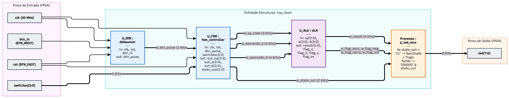
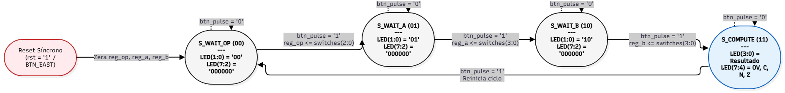
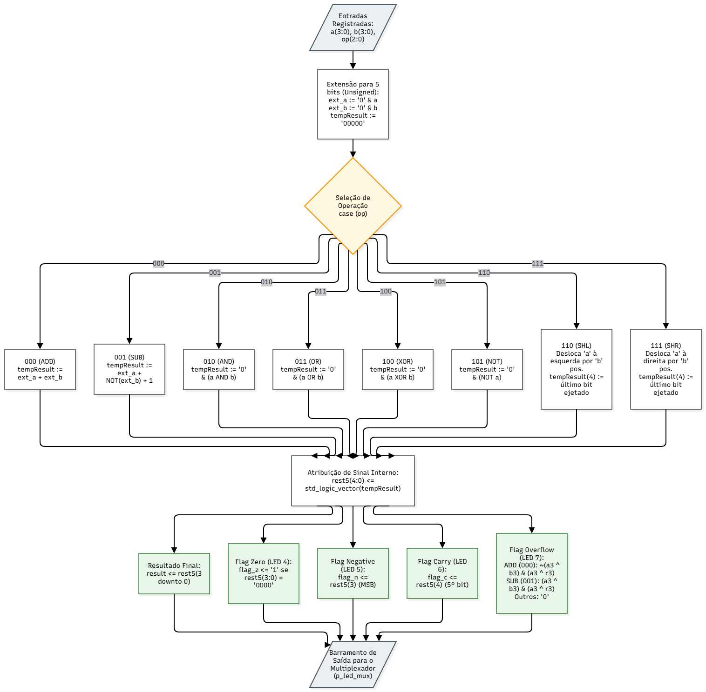

# Unidade Lógica e Aritmética (ULA) de 4 Bits em FPGA

-brightgreen.svg)

Projeto desenvolvido para a disciplina de **Sistemas Digitais** da **Universidade Federal do Rio de Janeiro (UFRJ)**. Consiste na implementação em hardware de uma **Unidade Lógica e Aritmética (ULA)** de 4 bits controlada por uma **Máquina de Estados Finitos (FSM)**, com filtro digital de ruído mecânico (*Debouncer*) e multiplexação de saída para o kit de desenvolvimento **Xilinx Spartan-3 Starter**.

---

## Autores

* **Matheus Nunes da Silva**
* **Luiz Henrique de Oliveira Vettorazzi**
* **Marcus Vinícius Alves Leandro**

---

## Arquitetura do Sistema

O projeto adota uma arquitetura modular estruturada na entidade de topo (`top_level`), integrando quatro blocos funcionais principais:

1. **Filtro de Debounce (`debauncer`):** Condiciona o sinal bruto do botão de confirmação (`btn_in`) operando sob o clock de 50 MHz (período de 20 ns). Implementa um sincronizador de duplo *flip-flop* para mitigar metaestabilidade, um contador de estabilidade de $1.000.000$ de ciclos (janela de $20\text{ ms}$) e um detector de borda de subida que gera um pulso limpo de exatamente 1 ciclo de clock (`btn_pulse`).
2. **Controlador FSM (`fsm_controller`):** Máquina de estados síncrona que contorna a limitação física de chaves da placa, permitindo a leitura sequencial da operação (`op` - 3 bits), do operando `A` (4 bits) e do operando `B` (4 bits) através do mesmo barramento físico de 4 *switches* (`switches<3:0>`).
3. **Unidade Lógica e Aritmética (`ULA`):** Circuito puramente combinacional que processa os operandos estendidos em 5 bits (`unsigned(4 downto 0)`) para capturar *Carry Out* e deslocamentos lógicos, gerando o resultado de 4 bits e quatro *flags* de status (`Zero`, `Negative`, `Carry`, `Overflow`).
4. **Multiplexador de Saída (`p_led_mux`):** Comuta dinamicamente os 8 LEDs da placa entre o modo de depuração de estado (exibindo o estado atual da FSM nos LEDs inferiores durante a entrada de dados) e o modo de execução (exibindo o resultado nos LEDs `3:0` e as *flags* nos LEDs `7:4`).
## Diagrama Toplevel

---

## Operações Suportadas pela ULA

A seleção da operação é definida pelos 3 bits menos significativos das chaves (`switches<2:0>`) no estado inicial:

| Código (`op`) | Operação | Descrição Técnica |
| :---: | :---: | :--- |
| `000` | **ADD** | Adição em complemento de 2 (`A + B`) |
| `001` | **SUB** | Subtração em complemento de 2 (`A + NOT(B) + 1`) |
| `010` | **AND** | Operação lógica `A AND B` bit a bit |
| `011` | **OR** | Operação lógica `A OR B` bit a bit |
| `100` | **XOR** | Operação lógica `A XOR B` bit a bit |
| `101` | **NOT** | Inversão lógica bit a bit de `A` (`NOT A`, operando `B` ignorado) |
| `110` | **SHL** | Deslocamento lógico à esquerda de `A` por `B` posições (último bit ejetado vai para `flag_c`) |
| `111` | **SHR** | Deslocamento lógico à direita de `A` por `B` posições (último bit ejetado vai para `flag_c`) |

---

## Máquina de Estados Finitos (Fluxo de Operação)

A interação com o usuário ocorre em 4 estados sequenciais avançados pelo botão `btn_in` (`BTN_WEST`):

* **`00` (`S_WAIT_OP`):** Aguarda a configuração do código da operação nas chaves `switches<2:0>`. Ao pressionar `btn_in`, armazena no registrador `reg_op` e avança.
* **`01` (`S_WAIT_A`):** Aguarda o valor do operando `A` nas chaves `switches<3:0>`. Ao pressionar `btn_in`, armazena em `reg_a` e avança.
* **`10` (`S_WAIT_B`):** Aguarda o valor do operando `B` nas chaves `switches<3:0>`. Ao pressionar `btn_in`, armazena em `reg_b` e avança.
* **`11` (`S_COMPUTE`):** Exibe nos LEDs o resultado da ULA e as respectivas *flags* de estado. Um novo pulso em `btn_in` retorna a máquina ao estado `S_WAIT_OP`.

> **Nota:** O botão de reset (`BTN_EAST`) é síncrono e restaura imediatamente os registradores internos e a máquina de estados para `S_WAIT_OP` (`00`).

---

## Mapeamento de Pinos (UCF — Spartan-3)

As restrições físicas e temporais (`TS_clk = 20 ns` / 50 MHz) estão configuradas conforme a tabela abaixo:

| Sinal no VHDL | Direção | Pino FPGA | Componente Físico / Função |
| :---: | :---: | :---: | :--- |
| `clk` | `in` | `E12` | Oscilador de Clock de 50 MHz |
| `rst` | `in` | `T16` | `BTN_EAST` (Reset Geral com Pull-Down) |
| `btn_in` | `in` | `U15` | `BTN_WEST` (Confirmação / Avanço de Estado) |
| `switches<3:0>` | `in` | `T9, U8, U10, V8` | Chaves Seletoras (MSB `T9` até LSB `V8`) |
| `led<3:0>` | `out` | `U19, U20, T19, R20` | Resultado (`S_COMPUTE`) ou Estado FSM (`led<1:0>`) |
| `led<4>` | `out` | `V19` | **Flag Zero (`Z`)** — Ativa quando `result = "0000"` |
| `led<5>` | `out` | `V20` | **Flag Negative (`N`)** — Bit de sinal (`result<3>`) |
| `led<6>` | `out` | `Y22` | **Flag Carry (`C`)** — Carry out aritmético ou bit deslocado |
| `led<7>` | `out` | `W21` | **Flag Overflow (`OV`)** — Transbordo em `ADD` / `SUB` |

## Diagrama de Transição de Estados (FSM)

O controle sequencial do sistema é realizado por uma **Máquina de Estados Finitos (FSM) do tipo Moore** (`fsm_controller`), sincronizada na borda de subida do clock de 50 MHz. Como o kit Spartan-3 disponibiliza um único barramento de 4 chaves seletoras (`switches<3:0>`) para a entrada de dados, a FSM multiplexa a leitura dos parâmetros no tempo através de quatro estados consecutivos:

1. **Estado Inicial e Reset Síncrono (`rst = '1'`):** O acionamento do botão `BTN_EAST` (`rst`) força a máquina a retornar imediatamente ao estado `S_WAIT_OP` (`00`) na próxima borda de subida do clock, limpando os registradores internos (`reg_op`, `reg_a` e `reg_b` recebem zeros).
2. **`S_WAIT_OP` (`00`) — Seleção da Operação:** Estado de espera pelo código da operação. Enquanto `btn_pulse = '0'`, a máquina permanece neste estado e os LEDs exibem o código `00` nos bits menos significativos (`led<1:0> = "00"`). Ao detectar um pulso válido do botão de confirmação (`btn_pulse = '1'`), os 3 bits inferiores das chaves (`switches<2:0>`) são armazenados em `reg_op` e a máquina avança para `S_WAIT_A`.
3. **`S_WAIT_A` (`01`) — Leitura do Operando A:** A saída de depuração atualiza os LEDs para `led<1:0> = "01"`. O circuito aguarda a configuração dos 4 bits do primeiro operando nas chaves. Com um novo pulso (`btn_pulse = '1'`), o valor de `switches<3:0>` é registrado em `reg_a` e ocorre a transição para `S_WAIT_B`.
4. **`S_WAIT_B` (`10`) — Leitura do Operando B:** Os LEDs indicam o estado `led<1:0> = "10"`. Ao pressionar novamente o botão de confirmação (`btn_pulse = '1'`), o barramento `switches<3:0>` é capturado no registrador `reg_b` e a FSM transita para o estado de execução `S_COMPUTE`.
5. **`S_COMPUTE` (`11`) — Exibição do Resultado e Flags:** Neste estado (`state_out = "11"`), o multiplexador de saída (`p_led_mux`) comuta o barramento de LEDs do modo de rastreamento de estado para o modo de exibição de resultados. Os LEDs inferiores (`led<3:0>`) passam a exibir o resultado de 4 bits calculado pela ULA, enquanto os LEDs superiores (`led<7:4>`) exibem as *flags* de status (`Overflow`, `Carry`, `Negative` e `Zero`, respectivamente). Um novo pulso em `btn_pulse = '1'` reinicia o ciclo de volta para `S_WAIT_OP` (`00`), permitindo uma nova operação sem necessidade de acionar o reset.

## Fluxograma Algorítmico da ULA (Caminho de Dados e Flags)

A entidade `ULA` opera como um circuito puramente combinacional sensível às variações dos barramentos `a(3:0)`, `b(3:0)` e `op(2:0)`. O fluxo de processamento interno é estruturado em quatro estágios principais:

1. **Extensão de Bits (5 Bits):** Antes da execução de qualquer operação, os vetores de entrada de 4 bits (`a` e `b`) são concatenados com um bit `'0'` à esquerda (`ext_a := '0' & a` e `ext_b := '0' & b`), convertendo-os para o tipo `unsigned(4 downto 0)`. Uma variável temporária de 5 bits (`tempResult`) é inicializada com `"00000"` para evitar a inferência de *latches* indesejados e permitir a captura natural do 5º bit (*Carry Out*).
2. **Decodificação e Execução (`case op`):**
   * **Operações Aritméticas (`000` e `001`):** A adição (`000`) soma diretamente os vetores estendidos (`ext_a + ext_b`). A subtração (`001`) aplica a aritmética de complemento de dois somando `ext_a` ao inverso bit a bit de `ext_b` acrescido de 1 (`ext_a + NOT(ext_b) + 1`).
   * **Operações Lógicas (`010` a `101`):** Executam as portas `AND`, `OR`, `XOR` e `NOT` (apenas sobre `a`, ignorando `b`) bit a bit sobre os 4 bits inferiores, forçando o 5º bit (`tempResult(4)`) para `'0'`.
   * **Operações de Deslocamento Lógico (`110` e `111`):** Converte o operando `b` para um inteiro (`shift_amt` de 0 a 15) que define o número de posições a deslocar o operando `a` à esquerda (`SHL`) ou à direita (`SHR`). O último bit ejetado da palavra de 4 bits é roteado diretamente para `tempResult(4)` para alimentar a *flag* de *Carry*. Para deslocamentos `N > 4`, tanto o resultado quanto o *Carry* recebem `'0'`.
3. **Atribuição ao Sinal Interno (`rest5`):** Ao final do processo combinacional, o valor de `tempResult` é convertido e atribuído ao sinal interno de 5 bits `rest5(4 downto 0)`.
4. **Extração do Resultado e Geração Paralela de Flags:** A partir do barramento `rest5`, as saídas físicas são derivadas concorrentemente:
   * **Resultado (`result`):** Recebe os 4 bits menos significativos `rest5(3 downto 0)`.
   * **Flag Zero (`flag_z` — LED 4):** Recebe `'1'` quando `rest5(3 downto 0) = "0000"`, e `'0'` caso contrário.
   * **Flag Negative (`flag_n` — LED 5):** Reflete diretamente o bit mais significativo do resultado (`rest5(3)`), que indica sinal negativo na representação em complemento de dois.
   * **Flag Carry (`flag_c` — LED 6):** Recebe o 5º bit (`rest5(4)`), indicando *Carry Out* aritmético ou o último bit ejetado nos deslocamentos (`SHL`/`SHR`).
   * **Flag Overflow (`flag_ov` — LED 7):** Avaliada exclusivamente nas operações aritméticas (`000` e `001`) através da análise dos bits de sinal (`a(3)`, `b(3)` e `rest5(3)`). Na soma (`000`), dispara quando operandos de mesmo sinal produzem resultado de sinal oposto (`NOT(a(3) XOR b(3)) AND (a(3) XOR rest5(3))`). Na subtração (`001`), dispara quando operandos de sinais opostos geram resultado com sinal diferente do minuendo (`(a(3) XOR b(3)) AND (a(3) XOR rest5(3))`). Nas demais operações, permanece em `'0'`.