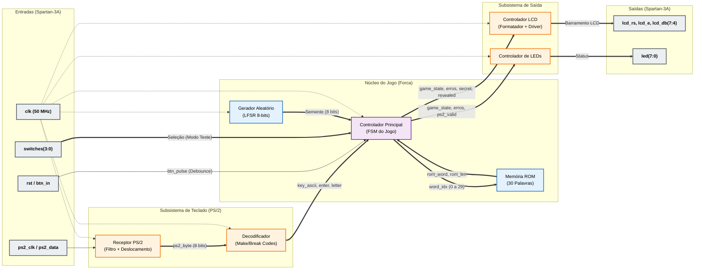

# Trabalho 2: Jogo da Forca em FPGA (Teclado PS/2 e Display LCD)

Este diretório contém o **Trabalho Prático 2** da disciplina de Sistemas Digitais (EEL480) da UFRJ. O projeto consiste em um **Jogo da Forca (Hangman Game)** interativo e autônomo, totalmente desenvolvido em hardware (VHDL) para o kit de desenvolvimento Xilinx Spartan-3A. O sistema cumpre os requisitos de comunicação avançada com periféricos, utilizando um teclado para a entrada de dados do usuário e um display LCD para o retorno visual.

---

## 👥 Autores

* **Matheus Nunes da Silva**
* **Marcus Vinícius Alves Leandro**
* **Luiz Henrique de Oliveira Vettorazzi**

---

## 🧠 Arquitetura do Sistema e Módulos

O design foi estruturado em uma arquitetura de múltiplos processos rodando de forma simultânea e independente. Isso garante que a máquina de estados (FSM) do jogo nunca trave aguardando o receptor do teclado ou a lentidão natural do display.

* **Receptor e Decodificador PS/2:** Trata os sinais assíncronos do teclado (`ps2_clk` e `ps2_data`). Implementa filtros contra ruídos (*glitches*), verifica a paridade ímpar do frame serial de 11 bits e decodifica os *Make Codes* e *Break Codes* (identificando teclas soltas ou pressionadas continuamente — *typematic*). Suporta letras de A a Z e a tecla ENTER.
* **Controlador de Display LCD (16x2):** Máquina de estados autônoma dedicada a inicializar o display no modo de 4 bits (`DB7..DB4`). O controlador varre continuamente um *buffer* interno de 32 caracteres gerado pelo jogo, atualizando a tela a cada ~1.8 ms respeitando rigorosamente os tempos de *setup* e execução dos comandos (ex: pulsos de 20 ms a 40 µs).
* **Gerador Pseudo-Aleatório (LFSR):** Registrador de deslocamento com realimentação linear (*Fibonacci LFSR* de 8 bits) que corre livremente a 50 MHz. A semente "congela" no momento exato em que o usuário aperta ENTER, garantindo a seleção imprevisível da palavra.
* **FSM Principal (Game Controller):** Controla o fluxo do jogo através dos estados `S_INIT`, `S_IDLE`, `S_NEW_GAME`, `S_LOAD_WORD`, `S_PLAYING`, `S_WIN` e `S_LOSE`. Contabiliza erros (limite de 6), revela as letras corretas e formata a interface de texto enviada ao *buffer* do LCD.
* **Memória de Palavras (ROM):** Banco de dados interno contendo 30 palavras temáticas da área de tecnologia e engenharia (ex: `CIRCUITO`, `HARDWARE`, `ALGORITMO`, `ROBOTICA`), com tamanhos variando até 10 letras[cite: 8, 9].

---

## 🔌 Mapeamento de Hardware (I/O)

O projeto mapeia os seguintes periféricos físicos configurados no arquivo `BOARD.ucf`:

| Porta VHDL | Pino FPGA | Função |
| :--- | :---: | :--- |
| `clk` | `E12` | Clock global do sistema (50 MHz) |
| `rst` | `T16` | Botão `BTN_EAST` - Reset Síncrono Global |
| `btn_in` | `U15` | Botão `BTN_WEST` - Funciona como tecla ENTER adicional |
| `ps2_clk` / `ps2_data` | `W12` / `V11` | Linhas de Clock e Dados do Teclado PS/2 (Open-Collector) |
| `lcd_rs` / `lcd_e` | `Y14` / `AB4` | Sinais de controle do Display LCD (Instrução/Dado e Enable) |
| `lcd_db<7:4>` | `Y15` a `AA12` | Barramento de dados do LCD (Modo 4 bits) |
| `switches<3:0>` | `T9` a `V8` | Modo Teste: Força a escolha de uma palavra específica (se $\neq$ 0000) |
| `led<7:0>` | `W21` a `R20` | LEDs de depuração (Qtd. Erros, Atividade PS/2, Status Win/Lose)[cite: 8] |

## 📊 Fluxograma

---

## 🎮 Como Jogar

1. **Inicialização:** Ao ligar a FPGA (ou pressionar o Reset `BTN_EAST`), aguarde o LCD inicializar. A tela exibirá o título **"FORCA"** e pedirá para pressionar ENTER.
2. **Começar o Jogo:** Pressione a tecla `ENTER` no teclado PS/2 (ou o botão `BTN_WEST`). O LFSR sorteará uma palavra oculta aleatória.
3. **Jogabilidade:** 
   * A linha superior do display exibirá a palavra com *underscores* (`_`) ocultando as letras.
   * A linha inferior mostrará o seu número de erros e a última letra digitada.
   * Pressione as letras de **A a Z** no teclado. Se errar, o contador de erros sobe. Se acertar, as posições daquela letra serão reveladas. Letras repetidas não custam novas tentativas.
4. **Fim de Jogo:**
   * **Vitória:** Se revelar todas as letras, a tela exibirá **"VOCE VENCEU!"**.
   * **Derrota:** Se atingir 6 erros, o jogo exibirá **"VOCE PERDEU!"** alternando com a revelação da palavra correta (**"ERA: [PALAVRA]"**).
5. **Novo Jogo:** Pressione `ENTER` a qualquer momento na tela de fim de jogo para sortear uma nova palavra e recomeçar[cite: 9].